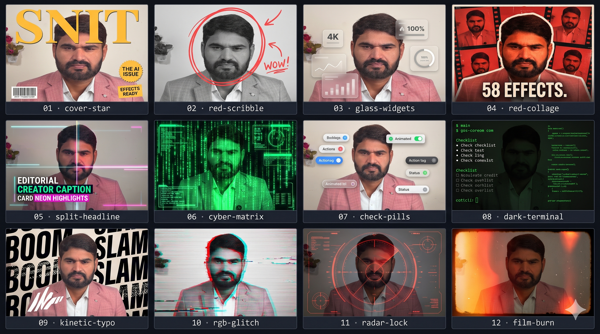

# 🎬 SNIT 58 Pro Motion Graphics & Video Effects for Claude AI

Turn any raw photo or talking-head video clip into an edited, 60fps motion-graphics reel using **Claude AI** — no Premiere Pro, After Effects, or CapCut needed.

---

## ⚡ Quick Start (3 Steps)

1. **[Download All 58 Effects Skill ZIP](https://github.com/SNITINSTITUE/SNIT-VIDEO-EFFECT-CLAUD-AI/archive/refs/heads/main.zip)** (1-click full pack).
2. **Open [Claude AI](https://claude.ai)** → go to **Settings > Skills > Upload a skill** and upload the downloaded `.zip` file (or attach it in chat with your **photo/video**).
3. **Paste this prompt** and press Enter:

> Apply the SNIT `06-cyber-matrix` (or any effect from `01` to `58`) video effect skill to my uploaded photo/video. Render the full-height 9:16 animated reel preview in Artifacts so I can play and export it.

---

## 📦 Complete 58 Motion Graphics Effects Library

| Category | Effect IDs & Names |
| :--- | :--- |
| **Core Signature Pack (01–08)** | `01-cover-star`, `02-red-scribble`, `03-glass-widgets`, `04-red-collage`, `05-split-headline`, `06-cyber-matrix`, `07-check-pills`, `08-dark-terminal` |
| **Kinetic Typography (09–18)** | `09-kinetic-slam`, `10-typewriter-cursor`, `11-highlighter-swipe`, `12-glitch-rgb-text`, `13-word-pop-bounce`, `14-strikethrough-swap`, `15-neon-flicker-sign`, `16-vertical-ticker`, `17-mask-reveal-bar`, `18-3d-flip-title` |
| **Cyber & Hacker HUD (19–28)** | `19-radar-target-lock`, `20-packet-sniffer-stream`, `21-firewall-shield-pulse`, `22-biometric-face-mesh`, `23-encryption-decrypt`, `24-system-breach-alert`, `25-circuit-board-trace`, `26-audio-waveform-hud`, `27-satellite-zoom-grid`, `28-binary-dissolve` |
| **Creator Social UI (29–38)** | `29-ios-notification-stack`, `30-youtube-sub-bell`, `31-imessage-chat-bubble`, `32-search-bar-autofill`, `33-instagram-reel-frame`, `34-podcast-mic-badge`, `35-tweet-quote-card`, `36-battery-low-panic`, `37-browser-window-pop`, `38-dm-share-arrow` |
| **Data & Charts (39–48)** | `39-rocket-growth-chart`, `40-counter-odometer`, `41-vs-split-duel`, `42-pie-ring-progress`, `43-step-roadmap-nodes`, `44-checklist-stagger`, `45-timer-countdown-ring`, `46-comparison-bar-race`, `47-pin-drop-callout`, `48-price-slash-tag` |
| **Cinematic & Transitions (49–58)** | `49-film-burn-leaks`, `50-vhs-retro-camcorder`, `51-cinematic-letterbox`, `52-parallax-3d-card`, `53-spotlight-vignette`, `54-glass-prism-refraction`, `55-halftone-comic-pop`, `56-paper-rip-collage`, `57-strobe-beat-flash`, `58-crt-tv-shutdown` |

---

### 🔗 Share Direct 1-Click Skill ZIP Link
Send this link to anyone for instant download of all 58 effects:
`https://github.com/SNITINSTITUE/SNIT-VIDEO-EFFECT-CLAUD-AI/archive/refs/heads/main.zip`
