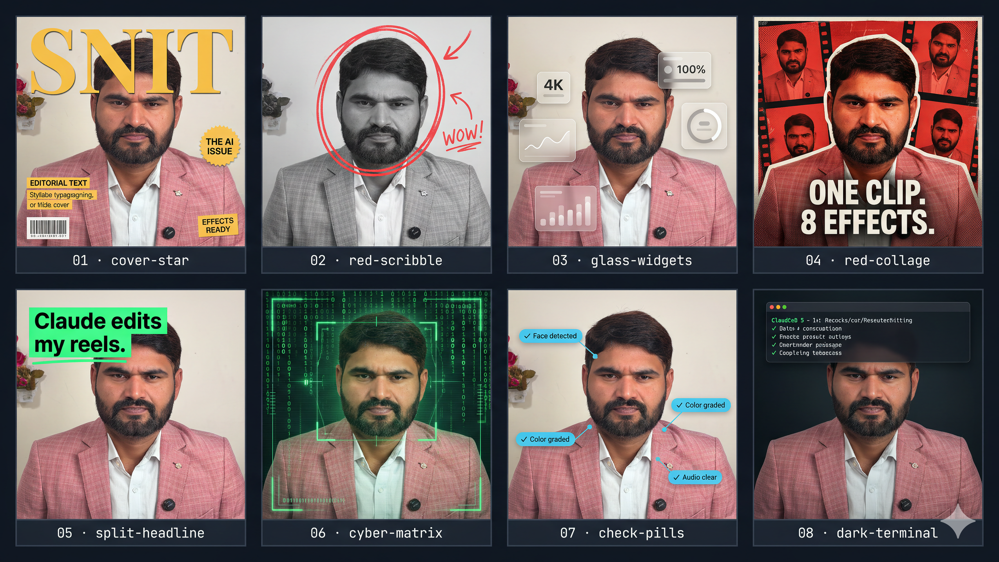

# 🎬 SNIT Video Effects for Claude AI

Turn any raw photo or talking-head video clip into an edited, motion-graphics reel using **Claude AI** — no Premiere Pro, After Effects, or CapCut needed.

---

## ⚡ Quick Start (3 Steps)

1. **Download an Effect ZIP** from the table below (or [Download All 8 Effects ZIP](https://github.com/SNITINSTITUE/SNIT-VIDEO-EFFECT-CLAUD-AI/archive/refs/heads/main.zip)).
2. **Open [Claude AI](https://claude.ai)** and upload the `.zip` file along with your **photo or video clip**.
3. **Paste this prompt** and press Enter:

> Apply this SNIT video effect skill to my uploaded photo/video. Render the full-height 9:16 animated reel preview in Artifacts so I can play and export it.

---

## 📦 Available Video Effects (Individual ZIP Downloads)

| # | Effect Name | Style & Motion | Direct Download |
| :--- | :--- | :--- | :--- |
| **01** | `cover-star` | Vintage magazine editorial cover + bold serif title | [Download ZIP](effects/01-cover-star.zip) |
| **02** | `red-scribble` | B&W monochrome focus + animated red circle callout | [Download ZIP](effects/02-red-scribble.zip) |
| **03** | `glass-widgets` | Frosted-glass UI cards, 4K badge & floating stats | [Download ZIP](effects/03-glass-widgets.zip) |
| **04** | `red-collage` | High-contrast red duotone poster + kinetic headline | [Download ZIP](effects/04-red-collage.zip) |
| **05** | `split-headline` | Editorial creator caption card with neon highlights | [Download ZIP](effects/05-split-headline.zip) |
| **06** | `cyber-matrix` | SNIT neon green `#39ff88` matrix rain & scanner HUD | [Download ZIP](effects/06-cyber-matrix.zip) |
| **07** | `check-pills` | Floating animated UI pill badges & action tags | [Download ZIP](effects/07-check-pills.zip) |
| **08** | `dark-terminal` | Dark-mode AI checklist terminal overlay | [Download ZIP](effects/08-dark-terminal.zip) |

---

### 🔗 Share Direct Full-Pack ZIP Link
Send this link to anyone for instant 1-click download of all 8 effects:
`https://github.com/SNITINSTITUE/SNIT-VIDEO-EFFECT-CLAUD-AI/archive/refs/heads/main.zip`
